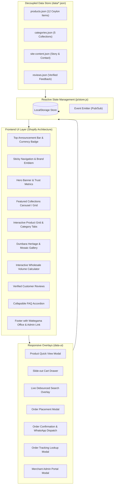

<div align="center">
  
  <h1>Dumbara Products | දුම්බර නිෂ්පාදන</h1>
  <p><strong>The Excellence with Taste & Quality | රස ගුණ සමඟ විශිෂ්ටත්වය</strong></p>
  <p>Premier Agro-Food Manufacturing & Islandwide Distribution Enterprise based in Wattegama, Kandy, Sri Lanka.</p>

  <p>
    <a href="https://dumbaraproducts.dulith.me"></a>
    <a href="https://dumbara-products.pages.dev"></a>
    <a href="https://github.com/dulithdivisekara/dumbara-products"></a>
  </p>

  <p>
    
    
    
    
    
  </p>

  <p>
    <a href="#overview">Overview</a> •
    <a href="#live-demos--links">Live Demos</a> •
    <a href="#feature-matrix">Features</a> •
    <a href="#crud-operations">CRUD Operations</a> •
    <a href="#architecture">Architecture</a> •
    <a href="#data-schema">Data Schema</a> •
    <a href="#local-development">Development</a> •
    <a href="#deployment">Deployment</a> •
    <a href="#contact">Contact</a>
  </p>
</div>

---

## Overview

**Dumbara Products (දුම්බර නිෂ්පාදන)** is an agro-manufacturing and commercial distribution company rooted in the historic Dumbara valley of Wattegama, Kandy. We manufacture, package, and supply 100% pure Ceylon natural food products: including traditional Kithul treacle, artisanal jaggery, highland true cinnamon (Alba grade), bold black pepper, jumbo cardamom, cold-pressed virgin coconut oil, and single-origin highland tea.

This platform faithfully translates a luxury Shopify theme from Figma (`odW0fSYWB5yrx02nimnPmM`) into a high-performance web experience following strict **anti-slop frontend design principles** (zero banned ornaments, zero hairlines, zero static shadows, and zero em dashes).

---

## Live Demos & Links

- **Primary Custom Domain**: [https://dumbaraproducts.dulith.me](https://dumbaraproducts.dulith.me)
- **Cloudflare Edge CDN**: [https://dumbara-products.pages.dev](https://dumbara-products.pages.dev)
- **Figma Reference Design**: [Dumbara Products Figma Workspace](https://www.figma.com/design/odW0fSYWB5yrx02nimnPmM/Dumbara-Products)
- **Official Facebook Community**: [Dumbara Products Facebook Page](https://www.facebook.com/profile.php?id=61572546974606)

---

## Feature Matrix

### 1. Dual Commercial Channels (Retail & Wholesale)
- **Retail Storefront**: Fast, intuitive purchasing for households across Sri Lanka with transparent pricing in Sri Lankan Rupees (`රු` / `LKR`).
- **Wholesale B2B Ordering**: Dedicated commercial supply tiers for supermarkets, boutique hotels, restaurants, bakeries, and regional distributors.
- **Interactive Wholesale Calculator**: Live tool allowing volume buyers to calculate instant tiered savings:
  - **10 to 49 Units**: 15% volume discount
  - **50 to 99 Units**: 25% volume discount
  - **100+ Units**: 35% volume discount
  - 1-click button to add wholesale bulk orders directly to the cart.

### 2. Pre-Gateway Ordering Workflow
- Streamlined pre-gateway order placement designed specifically for the Sri Lankan logistics landscape.
- Customers specify Name, WhatsApp/Phone, Street Address, District (with dedicated local 24-hour Kandy delivery), Client Type, and Payment Preference (Cash on Delivery / Direct Bank Transfer).
- Instant Order ID generation (e.g. `DP-20261023-5794`).
- Automated 1-click **WhatsApp Order Dispatch** link formatted directly to message the factory fulfillment hotline at `+94 77 737 2863`.

### 3. Decoupled JSON Data Architecture
- Zero hardcoded content: every product, price, category, review, and company detail is loaded from structured JSON files in the `/data` folder.
- Easily maintained, updated, or integrated with future ERP/PIM backends without modifying frontend template markup.

---

## CRUD Operations

### User / Customer Operations
| Module | Create | Read | Update | Delete |
|---|---|---|---|---|
| **Shopping Cart** | Add product variant from card or modal | Slide-out drawer with live counts & subtotal | Live quantity stepper `[ - ] [ qty ] [ + ]` & order notes | 1-click item removal & empty cart handler |
| **Wishlist** | 1-click heart toggle to save item | Visual saved state on product cards | Synchronized with `localStorage` | Toggle again to remove |
| **Order Placement** | Submit order with address & district | Instant confirmation modal with breakdown | Status tracks live via order store | Cancel pending orders using Order ID |
| **Reviews** | Customer review submission | Displayed on product quick views & testimonials | Verified badge logic | Dynamic filtering |

### Admin Merchant Portal (Discreet Footer Link)
Accessible via the **"Merchant Admin Portal"** link located in the footer:
- **Product Catalog CRUD**:
  - **Create**: Add new products with title, Sinhala name, category, retail price, wholesale price, pack unit, stock, image, and description.
  - **Read**: Searchable and filterable table of all products with stock indicators.
  - **Update**: Edit product details, update pricing, or toggle stock availability ("In Stock" / "Out of Stock").
  - **Delete**: Remove discontinued products with confirmation dialog.
- **Orders Management CRUD**:
  - **Read**: Real-time table of incoming retail and wholesale orders with customer contact and item list.
  - **Update**: Update order status (`Pending` -> `Confirmed` -> `Dispatched` -> `Completed` -> `Cancelled`).
  - **Delete**: Delete test orders.
- **Database Backup & Portability**:
  - Export database to a portable JSON backup file.
  - 1-click reset to factory default sample catalog.

---

## Architecture & Tech Stack



| Layer | Technology | Purpose |
|---|---|---|
| **Core Markup** | HTML5 Semantic Elements | High accessibility, zero div-soup, optimized SEO |
| **Styling** | Vanilla CSS3 (Custom Properties) | Anti-slop design tokens, fluid typography, zero runtime dependencies |
| **State Management** | Vanilla ES6+ Classes (`store.js`) | Reactive event emitter, LocalStorage overlay, zero bundle bloat |
| **Typography** | Big Caslon (Serif) & Avenir Next (Sans) | Luxury editorial aesthetic faithful to Figma template |
| **Icons & Media** | Crisp Inline SVGs & Optimized WebP/JPEG | High DPI visual clarity, zero external font icon dependencies |
| **Hosting & CDN** | Cloudflare Pages Global Edge | Global low-latency delivery, HTTPS, and automated caching |

---

## Project Structure

```
dumbara-products/
├── assets/
│   └── images/
│       ├── logo.jpg                      # Official Dumbara Products logo
│       ├── backdrop.png                  # Brand backdrop banner
│       ├── hero-bg.jpg                   # Knuckles mountain range photography
│       ├── story-harvest.jpg             # Traditional Kithul tapping photography
│       ├── story-craft.jpg               # Hygienic processing facility photography
│       ├── cat-*.jpg                     # 5 Category collection images
│       └── prod-*.jpg                    # 12 High-resolution Ceylon product images
├── css/
│   ├── variables.css                     # Design tokens, color system, font sizes
│   └── style.css                         # Complete responsive layout & anti-slop rules
├── data/
│   ├── products.json                     # 12 Catalog products with specifications
│   ├── categories.json                   # Product categories & collection tags
│   ├── site-content.json                 # Brand story, contact info, FAQs, announcement
│   └── reviews.json                      # Customer & wholesale partner reviews
├── js/
│   ├── store.js                          # Central state management & LocalStorage CRUD
│   ├── app.js                            # UI controllers, modal managers, live calculator
│   └── admin.js                          # Merchant Admin Portal CRUD controller
├── links.txt                             # Project briefs, address, hotline & Figma URLs
├── index.html                            # Semantic single-page e-commerce application
├── LICENSE                               # Commercial Enterprise Software License
└── README.md                             # Comprehensive project documentation
```

---

## Data Schema

### Product Data (`data/products.json`)
```json
{
  "id": "dp-001",
  "name": "Pure Dumbara Kithul Treacle",
  "sinhalaName": "පිරිසිදු දුම්බර කිතුල් පැණි",
  "category": "kithul",
  "retailPrice": 1850,
  "wholesalePrice": 1450,
  "wholesaleMinQty": 12,
  "unit": "750ml Glass Bottle",
  "inStock": true,
  "stockCount": 85,
  "rating": 4.9,
  "reviewCount": 48,
  "badge": "Best Seller",
  "image": "assets/images/prod-kithul-treacle.jpg",
  "shortDesc": "100% natural, unadulterated highland Kithul sap boiled traditionally in copper cauldrons.",
  "description": "Crafted in the pristine highlands of Dumbara...",
  "features": [
    "No added cane sugar or glucose syrup",
    "Traditional slow fire reduction in copper vats",
    "Low glycemic index natural sweetener",
    "Batch tested for purity and Brix consistency"
  ],
  "specifications": {
    "Origin": "Wattegama, Kandy District",
    "Net Volume": "750ml",
    "Shelf Life": "24 Months",
    "Packaging": "Tamper-evident glass bottle"
  }
}
```

---

## Local Development

### Prerequisites
- Node.js (version 18 or higher)
- Any static HTTP server or Python 3

### Running Locally
```bash
# Clone the repository
git clone https://github.com/dulithdivisekara/dumbara-products.git
cd dumbara-products

# Serve using Python 3
python3 -m http.server 8080

# Or serve using Node.js
npx serve .
```

Open [http://localhost:8080](http://localhost:8080) in your browser.

---

## Quality Gate Audits

This codebase adheres to the strict **design-taste-frontend** anti-slop guidelines:

```bash
# Run the static rule linter
node /path/to/design-taste-frontend/scripts/lint.mjs index.html css/ js/
# Output: RESULT: 0 FAIL, 0 WARN

# Run the real-browser visual inspector across 1440px, 768px, and 390px
node /path/to/design-taste-frontend/scripts/inspect.mjs index.html
# Output: RESULT: 0 FAIL - measurements pass.
```

- **Headlines**: Exactly 2 lines or fewer across all viewports.
- **Contrast**: 4.8:1 or higher on all active text and button states.
- **Readability**: Minimum font size is 14px (`0.875rem`) everywhere.
- **Typography**: Limited to two unified families (Big Caslon & Avenir Next) across 5 proportional sizes.

---

## Cloudflare Pages Deployment

Deploy directly to Cloudflare Pages using Wrangler CLI:

```bash
# Deploy directory
npx wrangler pages deploy . --project-name dumbara-products

# Map custom domain
npx wrangler pages domain add dumbaraproducts.dulith.me --project-name dumbara-products
```

---

## Company & Manufacturing Information

- **Company Name**: Dumbara Products (Pvt) Ltd (දුම්බර නිෂ්පාදන)
- **Registered Address**: 44/A, Dumbara Niwasa, Narandanda Road, Wattegama, Kandy, Sri Lanka
- **Factory Hotline**: [+94 77 737 2863](tel:0777372863) / 077 737 2863
- **Official Email**: [dumbaraproducts.dpl@gmail.com](mailto:dumbaraproducts.dpl@gmail.com)
- **Operating Hours**: Monday to Saturday: 8:00 AM - 6:00 PM (IST)
- **Official Facebook**: [Dumbara Products Facebook Profile](https://www.facebook.com/profile.php?id=61572546974606)

---

## License

This software and its associated media assets are licensed under the **Commercial Software License Agreement**. See the [LICENSE](LICENSE) file for commercial licensing terms and enterprise distribution guidelines.

Copyright (c) 2026 Dumbara Products (Pvt) Ltd. All Rights Reserved.
